# Programmer documentation

## Application design

At first the options from CLI are parsed (see [user documentation](user.md)), then if the options are correct an
instantiation of function template `RunDB` found in `src/CLI/Runner.hpp` is called and the database is running. Database
runs in two threads:

1. reader thread
    - this thread just reads input stream specified when calling `RunDB` (currently `std::cin`) and pushes lines that
      are read into `std::queue` shared with main thread
2. main thread
    - this thread does all the important work
    - thread works in cycles:
        1. It checks `std::priority_queue<QueueEntry>`, that holds information about expiration of database entries. On
           top of the priority queue is entry, that will expire first. If the entry on top of the queue is expired it
           pops it from the queue and removes associated entry from database
        2. It checks if there is a new line (operation od database) in `std::queue` shared with reader thread, if there
           is, it pops it from the queue and executes the operation
        3. repeat

## UML diagram

The picture can be found in `docs/diagram_full.svg`

## `src/DBCore`

This folder contains the core components of the engine. It is structured into three folders:

- `BDEntry`
- `SwissTable`
- `Hashfunction`

### `DBEntry`

This folder contains classes used to represent specific entries to database.

- `class String`
    - uses `std::string` for internal value representation
    - `class PrefixAut` is class used for searching for occurrences of substring using the Knuth-Morris-Pratt algorithm
    - constructor accepts either R-value reference or const L-value reference to `std::string` or `char` value for
      construction of `String` consisting of one character, default constructor is also available:
        - `String(const std::string &val)`
        - `String(std::string &&val)`
        - `String(char ch)`
        - `String()`
            - constructs instance with empty value of internal `std::string`
    - static function `String Concatenate` takes two arguments: `String valLeft` and `String valRight` and returns new
      `String`
      instance, whose value is the concatenation of `valLeft + valRight`
        - this function accepts either both L-value reference arguments or both R-value arguments:
            - `String Concatenate(const std::string &valLeft, const std::string &valRight)`
            - `String Concatenate(std::string &&valLeft, std::string &&valRight)`
            - `String Concatenate(String &&valLeft, String &&valRight)`
    - `char operator` - operator for accessing i-th character in String
    - `Find(const String &valToFind)` method finds all occurrences of its argument `valToFind` in `this`
    - `bool operator==` compares internal values of `std::string`
    - `std::size_t Size()` returns number of characters in String
    - `operator<<` dumps the internal `std::string` into specified stream
    - `void RemovePrefix(size_t n)` - removes first `n` characters of `this`
    - `void RemoveSuffix(size_t n)` - removes last `n` characters of `this`
- `class Object`
    - Is a class used to represent database value type `object`
    - For avoiding circular dependency, the declaration of class interface is in file
      `src/DBCore/DBEntry/ValueTypes.hpp`, this file is then included in `Object.hpp`
    - In `src/DBCore/DBEntry/ValueTypes.hpp` an alias `PrimitiveValuePack` is defined, this alias holds all value types,
      that are available for fields of object to hold, in a `std::tuple`.
    - In `src/DBCore/DBEntry/ValueTypes.hpp`, there is a struct `ValueType`, that is used to infer type of actual type
      of field value representation, it takes a `std::tuple` template and defines struct alias
      `ValueType<Args ...>::type`, that is a type `std::variant<Args ...>`
    - For representation of fields of an object, instance of `std::unordered_map<Key, Value>` is used
        - `Key` is an alias for `std::string`
        - `Value = ValueType<PrimitoveValuePack>::type`, which is a `std::variant` with all value types, that are
          possible
    - class can be constructed with an iterator pair into `std::vector<std::pair<Key, Value>>`, this constructs an
      instance with fields, that are in the vector between specified iterators, where the pair specifies field name and
      the value of that field:
        -
      `Object(std::vector<std::pair<Key, Value>>::iterator first, std::vector<std::pair<Key, Value>>::iterator last)`
        - `Object()`
            - constructs object with empty instance of `std::unordered_map<Key, Value>`
    - `T get_member(const Key &name)` function template, that takes a key and returns a value, that is stored under only
      argument of type `Key`, argument of function template is the value type, that is expected to be stored under
      specified field name
    - `void dump_to_stream(std::ostream& stream, const Key &key)`
        - dumps the field named `key` into `stream`
        - assumes, that field named `key` exists
    - `void set_value(const Key &name, const T &value)` function template, that stores `value` under `name` field name,
      template of the function is the value type of `value`, function has two overloads, for `value` being passed as an
      r-value of l-value reference
    - `bool has_member(const Key &name)` function, that returns `true`, if the instance contains a field under a `name`,
      otherwise returns `false`
    - `std::size_t MemberCount()` function, that return number of fields currently stored in the instance
    - `operator<<` overload, that dumps the object into specified stream in format:
      `{field1: value1, field2: value2, ...}`
- `class Timepoint`
    - class used to measure time elapsed from some timepoint
    - at construction uses `std::chrono::steady_clock` for getting a timepoint and later compares it to current
      timepoint taken using the same clock
        - `std::chrono::steady_clock` is used, because timepoints of this clock cannot decrease as time goes on
    - `Timepoint()` constructs an instance, takes a timepoint
    - `bool Elapsed(T &&val)` function template, that takes value `val` of type `T`, function template `T` must be
      specialization of `std::chrono::duration` (it must be possible to cast duration values to this type). Function
      returns `true` if time specified as value `val` has elapsed since creation of this object, otherwise returns
      `false`.
    - `T RemainingTime(T &&val)` function template, that takes value `val` of type `T` with same traits as parameter of
      function
      `Elapsed`. This function returns remaining time before the time `val` elapses since the construction of this
      object. Return value if of type `T`, if time `val` has already elapsed the function returns `T(0)`.
- `class DBEntry_t<typename E, typename T>`
    - class template used to store entries into database, `E` specifies the type of entry that is to be stored in the
      database and `T` specifies a type used for specifying time to live, `T` must be specialization of
      `std::chrono::duration`
    - instance of instantiation of this class template holds:
        - `E payload` - actual value stored in this entry
        - `Timepoint timepoint_` - used for measuring if entry is already expired
        - `T ttl` - time for the instance to live - used for comparing against `timepoint_`
        - `QueueEntry *entryPointer` - pointer to entry of priority queue used for tracking expired entries. This
          pointer is used to invalidate the entry in priority queue, so the entry won't be removed more than once
    - `DBEntry_t(EC &&payload, TC &&ttl, QueueEntry *pointer)` - only constructor, `payload` is the value to be stored,
      `ttl` is time to live of the entry, `pointer` is pointer to priority queue
    - `E GetRef()` - returns reference to payload
    - `SetVal(ES &&val)` - function template used for setting the value of entry, template uses forwarding reference
    - `bool Expired()` - function to evaluate if entry is expired
    - `T RemainingTime()` - function used for getting remaining time of entry
    - `void Invalidate()` - invalidates entry in priority queue used for time to live using `entryPointer`
    - class template has partial specialization `DBEntry_t<E, ImmortalSentinel>`
        - this specialization is used for entries, that do not have set a time to live, where `ImmortalSentinel` is
          empty class
        - function `Expired` always returns `false`
        - function `RemainingTime` always returns `std::chrono::milliseconds::max()`
- `class DBEntry<E>`
    - class template used for type erasure of `T` template parameter of `DBEntry_t`. This class exists so that entries
      with multiple different types of time to live can be stored in one database instance
- `class Null`
    - class used as a value of optional fields of `object` entries, that are not set
    - `bool operator==` - always returns `true`A
    - `operator<<` - dumps string `null` into stream
- `ValueTypes.hpp`
    - header used for including all possible database entries
        - `String`
        - `Integer`
        - `Float`
        - `Object`
        - `Vector<T>`
    - header also contains declaration of class `Object`

### `SwissTable`

Contains classes used for declaration of `class SwissTable`, which serves as a hash table. Swiss Table is a hash map
design, explained for example [here](https://go.dev/blog/swisstable).

- `class Vector`
    - class creating object similar to `std::vector`
    - used for representation of backing-array
- `class Group`
    - used for representation of groups in Swiss Tables
    - all indexes in some inputs/outputs of this class, can be used to directly access data in backing-array - these
      indexes point to positions in backing array
    - `std::vector<uint8_t>` is used internally to represent the control word of a group
    - `start` and `end` indicate where in backing array the group starts and where it ends, `end` points to value just
      after last value in this group
    - `LookUp` method tries to find occurrence of specified h2 hash, if it does not find any it tries to find empty
      space,
        - when hash is found in group, pair `<LookupRes::USED, std::vector<size_t>>` is returned, where the vector
          contains all occurrences of specified h2 in this group
        - when hash is not found and there is empty slot in this group - indicating, that value we are searching for is
          not in hash map yet, method returns pair `<LookupRes::EMPTY, std::vector<size_t>>`, where the vector contains
          all empty indexes in this group
        - when hash in found and the group is full, the pair `<LookupRes::FULL, std::vector<size_t>>` is returned, where
          the vector can be ignored since it does not contain any useful data
    - `SetVal` sets specified hash as a value stored at a specified position in group
    - `Delete` deletes value at specified position in group
    - `Used` method return `true` if specified position in a group is in use, returns `false` otherwise

- `class Entry`
    - instance of this class is used for altering position in a hash map, that is associated with some key
    - `GetResult` return result of look up of some key
        - when key has been found, returns `LookupRes::USED`
        - when key has not been found, returns `LookupRes::EMPTY`
    - `DeleteEntry` deletes entry associated with looked up key
    - `SetValue` sets value associated with looked up key to value specified as argument, accepts both L-value and
      R-value references
    - `GetValue` returns reference to value associated with looked up key

- `class SwissTable`
    - contains `Vector` with instances of groups, `Vector` with keys and `Vector` with value, variable `dataCount`
      contains number of values actually inserted in hash map
    - class has only default constructor
    - `LookUp` returns instance of `Entry` that can be used to access/delete/update value associated with specified key
    - `Rehash` method expands the backing array and inserts all value in the hash map
    - `Delete` method deletes value at specified position in backing array
    - `SetValue` method sets the value at specified position in backing array to specified value, h2 hash of the key
      must be specified, method accepts both L-value and R-value references to value that is to be inserted
    - `GetValue` method returns reference to value at specified position in backing array
    - `GetNextGroup` returns index of next group when sequentially iterating over groups
    - `CheckExistence` checks if key actually exists in certain group with specified lookup result from this group of
      the keys h2 hash, returns `std::pair<bool, size_t>` where `bool` specifies whether key was actually found and
      `size_t`
      specifies the index in backing array where the key actually is

### `HashFunction`

Contains implementation of a Sip hash hashing function. Information about SipHash can be
found [here](https://eprint.iacr.org/2012/351.pdf). Key is chosen randomly on database startup. SipHash-2-4 is used.

## `src/CLI`

### `DBType`

Contains definitions of enums, functions associated with parsing of startup arguments and inferring type of database at
compile time.

- enum class `DBTypes`
    - enum, that is used to specify what types of entries will be stored in a database
- struct `get_db_type`
    - `DBTypes` type tag used to infer type of database based on template argument
- enum class `StartupTokens`
    - used when parsing startup options to know what to parse
- enum class `TTLTypes`
    - used for specifying what unit of time is used for time to live
- enum class `ObjectFieldTypes`
    - used for specifying what type is field of object
- enum class `SplitFieldRes`
    - used for specifying result of splitting string representation of object into vector of strings, containing
      individual fields
- `using view_t = std::ranges::subrange<std::vector<std::string>::iterator>`
- enum class `ObjectParseRes`
    - used for specifying result of parsing of a string representation of an object
- `StartupTokens GetOptionToken(view_t &args)`
    - function used for parsing next token in startup arguments
- `std::pair<variant_t, TTLTypes> GetTTL`
    - used for parsing representation of time to live after parsing its option
- `DBTypes GetType(viev_t &args)`
    - used for parsing type of database entries after parsing its option
- `std::tuple<DBTypes, ttl_t, Object, object_reference> GetDBType(view_t &args)`
    - function used for parsing database entry type and time to live for entries
- `std::tuple<ObjectParseRes, Object, object_reference> ParseObjectStructure(view_t &viewIn)`
    - function used for parsing object structure on database startup, when entries are of type object

### `Error`

Contains functions, that return strings of errors, that may occur while executing database operations

- `err_t = std::vector<std::string>`
    - alias for setting tye of errors
    - it is a vector of strings, because it makes it easier for creation of parametrized errors
- `err_t CouldNotOpenFileErr(const std::string &file)`
    - returns error, when some file could not be opened
    - returns: `{"Could not open file: ", file}`
- `err_t CouldNotReadFileErr(const std::string &file)`
    - returns error, when some file could not be read
    - returns `{"Could not read file: ", file}`
- `err_t InvalidArgs()`
    - returns error, when invalid arguments were passed to database operation
    - returns `{"Invalid arguments"}`
- `err_t InvalidArgsCount(const std::size_t expected, const std::size_t actual)`
    - returns error, when invalid number of arguments was passed to database operation
    - return `{"Invalid number of arguments, expected: ", std::to_string(expected), ", got: ", std::to_string(actual)}`
- `err_t InvalidOperation()`
    - returns error, when invalid operation was run on database instance, f.e. object operation was run on integer
      database
    - returns `{"Invalid operation"}`
- `err_t InvalidField(const std::string &field)`
    - returns error, when field of an object is invalid
    - returns `{"Invalid field: ", field}`

### `Nodes`

Contains definition of classes used as a nodes of a syntax tree, that are being used when executing database operations

#### `BaseNode.hpp`

Contains abstract class `BaseNode`

#### `DBNodes.hpp`

Contains nodes, that execute operations on database

- alias template `DBType<T>`
    - specifies exact type of database, with `T` being the type od database entry
- abstract class `DBopsNodeBase`
    - this abstract class inherits from `BaseNode`
    - `virtual void Execute()` - executes database operation
- class template `DBopsNode<T>`
    - inherits from `DBopsNodeBase`
    - adds protected reference to database of type `DBType<T>`
    - `DBopsNode(DBType<T> &db)` - constructor
        - `db` is stored as a reference
- class templates for all operations on database
    - `InsertNode` - inserts result of operation into database
    - `GetNode` - retrieves entry from database
    - `DeleteNode` - deletes entry from database
    - `ErrorNode` - prints out any error, that may have happened during the evaluation of operation
- class template `ToStreamNode`
    - used for dumping result of an operation into outstream
- class `ObjectGetNodeToStream`
    - inherits from `DBopsNodeBase`
    - used for dumping fields of entries of type `object` into output stream

#### `Nodes.hpp`

Header file that includes all necessary headers with node classes for simpler including

#### `OpNodes`

Contains nodes, that execute operations on instances of types, that can be database entries

- abstract class template `Node<T>`
    - inherits from `BaseNode`
    - `virtual T Execute()`
        - executes the operation and returns result
- class template `ConstandtNode<T> : Node<T>`
    - used, when constant values are used in operations
- classes for all operations on String values:
    - `ConcatStrings : Node<String>` - used for concatenating strings
    - `SuffixNode : Node<String>` - used for getting suffix of a string
    - `PrefixNode : Node<String>` - used for getting prefix of a string
    - `AtNode : Node<String>` - used for getting character at specified position
    - `FindNode : Node<Vector<Integer>>` - used for finding all occurrences of a substring
        - this node returns vector of integers
- class template `BinaryOp<T> : Node<T>` - used for all operations on number values
    - class templates inherit from this class template, where `T` is `Integer` or `Float`:
        - `AddOp<T> : BinaryOp<T>` - adds two numbers
        - `SubtractOp<T> : BinaryOp<T>` - subtracts two numbers
        - `DivideOp<T> : BinaryOp<T>` - divides one number by other
        - `MultiplyOp<T> : BinaryOp<T>` - multiplies two numbers
- class templates for operations on vectors:
    - `AppendNode<T> : Node<Vector<T>>` - appends value to a copy of a vector
    - `PopNode<T> : Node<Vector<T>>` - removes last value from a copy of vector
    - `VInsertNode<T> : Node<Vector<T>>` - inserts value at a specified position in a copy of vector
    - `RemoveNode<T> : Node<Vector<T>>` - removes value from specified position in a copy of vector
    - `SetNode<T> : Node<Vector<T>>` - sets a value at a specified position of a copy of vector to a specified value
    - `VgetNode<T> : Node<T>` - returns value at a specified position in a vector
    - `SizeNode : Node<Integer>` - returns the size of a vector
- class templates for operations on objects
    - `ObjectGetNode<T> : Node<T>` - returns value stored in a field of vector
    - `ObjectSetNode<T> : Node<Object>` - sets a value to a specified field in a copy of vector

### `OperationType`

Contains functions for parsing operations

- struct `vector_t`
    - used for inferring type of values stored in a vector
- enum class `OPType`
    - used for representing operations at runtime
- `std::size_t GetArgCount(OPType op)`
    - returns number of expected arguments for specified operation
- alias `view_t = std::ranges::subrange<std::vector<std::string>::iterator>`
- `OPType GetOPType(view_t &args)`
    - returns what operation to parse, based on first value in `args`
- `bool ValidateOPType(OPType op, DBTypes dbType)`
    - returns `true`, if `op` is valid operation on database of type `dbType`

### `Parser`

Contains functions used for parsing database operations.

- enum class `ArgsType`
    - used to represent what type of argument has been parsed
- alias `args_parsed = std::pair<ArgsType, std::string>`
- function `args_parsed ParseArg(view_t &args)`
    - parses an argument in `args`
- enum class `GetArgsReturnTypes`
    - used to represent if the parsed argument has valid type based on desired type and type, that will be received from
      `args_parsed`
- function `std::tuple<std::string, ObjectFieldTypes, std::string> ParseField(std::string_view view)`
    - tries to parse one field of string representation of object
    - returns tuple, where:
        - first is name of the field
        - second is type of the field
        - third is string representation of actual value
    - when valid field has been parsed, second must equal `ObjectFieldTypes::VALID`
- alias `parse_res<T> = std::pair<bool, T>`
- function `parse_res<String> ParseString(std::string_view input)`
    - tries to parse constant value of String value in a format of: `'[Actual Value]'`
    - when successful returns `true` and value
    - otherwise returns `false` and something
- function template `bool ValidKey<DB>(DB &db, const std::vector<uint8_t>& key)`
    - returns `true`, if entry with `key` exists in database `db`
- function template `std::pair<GetArgsReturnTypes, StringPtr> getString<DB>(DB &db, args_parsed &&args)`
    - tries to parse node returning String, based on `args` and type of database as a template argument `DB`
    - if not successful, returns `GetArgsReturnTypes::INVALID` and invalid pointer
    - otherwise returns `GetArgsReturnTypes::VALID` and valid pointer
- function `parse_res<Integer> ParseInt(std::string_view input)`
    - tries to parse constant value of Integer value
    - when successful returns `true` and value
    - otherwise returns `false` and something
- function template `std::pair<GetArgsReturnTypes, NumberPtr<Integer>> getInteger<DB>(DB &db, args_parsed &&args)`
    - tries to parse node returning Integer, based on `args` and type of database as a template argument `DB`
    - if not successful, returns `GetArgsReturnTypes::INVALID` and invalid pointer
    - otherwise returns `GetArgsReturnTypes::VALID` and valid pointer
- function `parse_res<Float> ParseFloat(std::string_view input)`
    - tries to parse constant value of Float value
    - when successful returns `true` and value
    - otherwise returns `false` and something
- function template `std::pair<GetArgsReturnTypes, NumberPtr<Float>> getFloat<DB>(DB &db, args_parsed &&args)`
    - tries to parse node returning Float, based on `args` and type of database as a template argument `DB`
    - if not successful, returns `GetArgsReturnTypes::INVALID` and invalid pointer
    - otherwise returns `GetArgsReturnTypes::VALID` and valid pointer
- enum class `VectorParsingRes`
    - used to represent result of parsing string representation of vector
- function
  `std::pair<VectorParsingRes, Vector<T>> ParseVect(std::string_view input, std::function<std::pair<bool, typename vector_t<T>::type>(std::string_view)> converter)`
    - tries to parse constant value of Vector containing values of type `T`, with `converter` used as a function, that
      parses string representation of values of type `T`
    - when successful returns `VectorParsingRes::VALID` and value
    - returns `VectorParsingRes::INVALID_VECT` for invalid syntax
    - returns `VectorParsingRes::INVALID_ITEM` for invalid item
- function template
  `std::pair<GetArgsReturnTypes, VectPtr<T>> getVector<T, DB>(DB &db, args_parsed &&args, std::function<std::pair<bool, typename vector_t<T>::type>(std::string_view)> converter)`
    - tries to parse node returning Vector<T>, based on `args` and type of database as a template argument `DB`
    - `converter` is used to parse values in constant value of vector
    - if not successful, returns `GetArgsReturnTypes::INVALID` and invalid pointer
    - otherwise returns `GetArgsReturnTypes::VALID` and valid pointer
- function template `std::pair<GetArgsReturnTypes, VectPtr<T> > getVectorFromDB<T, DB>(DB &db, args_parsed &&args)`
    - does the same thing as `getVector`, only difference is that only returns valid value, when argument parsed is key
      into database and type of database is correct
- function
  `parse_res<Object> ParseObject(std::string_view input, Object referenceObject, const object_reference &reference))`
    - tries to parse constant value of Object
    - builds the new object using `referenceObject`, where optional fields are already set to `null` and `reference` to
      check correct types of fields
    - when successful returns `true` and value
    - otherwise returns `false` and something
- function template
  `std::pair<GetArgsReturnTypes, NodePtr<Object> > getObject<DB>(DB &db, args_parsed &&args, const Object &referenceObject, const object_reference &reference)`
    - tries to parse node returning Object, based on `args` and type of database as a template argument `DB`
    - `referenceObject` and `reference` are used for building object from constant
    - if not successful, returns `GetArgsReturnTypes::INVALID` and invalid pointer
    - otherwise returns `GetArgsReturnTypes::VALID` and valid pointer
- function template `std::pair<GetArgsReturnTypes, NodePtr<Object> > getObjectFromDB<DB>(DB &db, args_parsed &&args)`
    - does the same thing as `getObject`, only difference is that only returns valid value, when argument parsed is key
      into database and type of database is correct
- enum class `ParseOperationRes`
    - used to represent result of a parsing of database operation
- alias `parse_op_r<N> = std::pair<ParseOperationRes, std::unique_ptr<N> >`
- function template `parse_op_r<N> ParseIntNode<DB, N>(view_t &view, DB &db)`
    - parses operation of type `N` on integer values with provided database of type `DB`
    - `N` is node class used to represent desired operation
    - `N` must be operation with 2 operands of type `Integer`
- function template `parse_op_r<N> ParseFloatNode<DB, N>(view_t &view, DB &db)`
    - parses operation of type `N` on float values with provided database of type `DB`
    - `N` is node class used to represent desired operation
    - `N` must be operation with 2 operands of type `Float`
- function template `parse_op_r<N> ParseStringOpStringNum<DB, N>(view_t &view, DB &db)`
    - used for parsing operation on string values of type `N` with provided database of type `DB`
    - `N` is node class used to represent desired operation
    - `N` must be operation with 2 operands of types `String` `Num` in this order
- function template `parse_op_r<N> ParseStringOpStringString<DB, N>(view_t &view, DB &db)`
    - used for parsing operation on string values of type `N` with provided database of type `DB`
    - `N` is node class used to represent desired operation
    - `N` must be operation with 2 operands of types `String` `String` in this order
- function template `parse_op_r<OP> ParseVectOpVectVal<DB, OP, T>(view_t &view, DB &db)`
    - used for parsing operation on vector values with items of type `T` of type `OP` with provided database of type
      `DB`
    - `OP` is node class used to represent desired operation
    - `OP` must be operation with 2 operands of types `Vector<T>` `T` in this order
- function template `parse_op_r<OP> ParseVectOpVect<DB, OP, T>(view_t &view, DB &db)`
    - used for parsing operation on vector values with items of type `T` of type `OP` with provided database of type
      `DB`
    - `OP` is node class used to represent desired operation
    - `OP` must be operation with 1 operand of type `Vector<T>`
- function template `parse_op_r<OP> ParseVectOpVectNumVal<DB, OP, T>(view_t &view, DB &db)`
    - used for parsing operation on vector values with items of type `T` of type `OP` with provided database of type
      `DB`
    - `OP` is node class used to represent desired operation
    - `OP` must be operation with 3 operands of types `Vector<T>` `Integer` `T` in this order
- function template `parse_op_r<OP> ParseVectOpVectNum<DB, OP, T>(view_t &view, DB &db)`
    - used for parsing operation on vector values with items of type `T` of type `OP` with provided database of type
      `DB`
    - `OP` is node class used to represent desired operation
    - `OP` must be operation with 2 operands of types `Vector<T>` `Integer` in this order
- function template
  `std::pair<ParseOperationRes, std::unique_ptr<DBopsNodeBase> > ParseObjectGet<DB>(view_t &view, DB &db, object_reference &reference, std::ostream &outstream)`
    - used for parsing operation `OGET` on object values with provided database of type `DB`
    - `reference` is used for checking if accessed field exists
    - `outstream` is where the result of get should be dumped
- function template
  `std::tuple<ParseOperationRes, NodePtr<Object>, ObjectFieldTypes, std::string> ParseObjectSet<DB>(view_t &view, DB &db, object_reference &reference)`
    - used for parsing operation `OSET` on object values with provided database of type `DB`
    - `reference` is used for checking if the field that is to be set exists
    - function returns:
        1. result of parsing
        2. pointer to node, that returns copy of the object
        3. type of field, that is accessed
        4. name of field, that is accessed
- enum class `KeyType`
    - used for representing what type of key has been specified
- function `std::pair<KeyType, std::string> ParseKey(view_t &view)`
    - used for parsing of operand, that is key into database
- function `std::pair<TargetType, std::string> ParseTarget(view_t &view)`
    - used for parsing a target of operation, target is one of following
        - key into database
        - file where to store the result
- function `ttl_t ParseTTL(view_t &view, ttl_t defaultTTL)`
    - used for parsing time to live of results of operations
    - tries to find option `--ttl` in `view`, if it finds it, returns specified time to live, otherwise returns
      `defaultTTL`
- function template `parse_op_r<DBopsNode<T> > ParseOneKeyOP<T, N>(view_t &view, std::ostream &stream, DBType<T> &db)`
    - parses operation `N` with one operand representing key into database `db`
    - `N` is node class used to represent desired operation
- function template `parse_op_r<DBopsNode<T> > ParseDelete<T>(view_t &view, DBType<T> &db)`
    - used for parsing of delete operation on database of type `DBType<T>`
- function template
  `parse_op_r<DBopsNode<T> > ParseInsert<T>(view_t &view, DBType<T> &db, ttl_t ttl, ttlQueueType &queue)`
    - used for parsing insert operation on database of type `DBType<T>`
- function
  `parse_op_r<DBopsNode<Object> > ParseInsert(view_t &view, DBType<Object> &db, ttl_t ttl, ttlQueueType &queue, const object_reference &reference, const Object &referenceObject)`
    - used for parsing insert operation on database of type `DBType<Object>`
    - `reference` is used for parsing the string representation and checking if the values represent correct types
    - `referenceObject` is used for building object, that is to be inserted into database
        - all optional fields are set to `null` in `referenceObject`
- function
  `std::unique_ptr<ErrorNode> GetError(ParseOperationRes res, std::size_t expected, std::size_t actual, std::ostream &outstream, const std::string &file)`
    - returns pointer to `ErrorNode`, that returns error based on `res`
    - used for receiving correct error based on result of parsing, that is not valid
    - `expected` and `actual` are used only whe `res` is `ParseOperationRes::INVALID_ARG_C`
    - `oustream` is stream, where the error should be dumped
    - `file` is name of file, that could not be opened or read
- function `bool HasTarget(OPType op)`
    - returns `true`, if `op` represents operation, that needs target, where the result should be stored, otherwise
      returns `false`

### `QueueEntry`

Instances of class `QueueEntry` are stored in priority queue used for time to live, they manage time left to live and
own a key for accessing value, that it is invalidating. Entries in database of type `DBEntry` hold pointer to these
entries for invalidating them. This is a reason why there are `std::unique_ptr<QueueEntry>` stored in the priority queue
rather than objects.

- class `QueueEntry`
    - constructor `QueueEntry(std::chrono::milliseconds ttl, const std::vector<uint8_t> &key)`
        - constructs new object with time to live as `ttl` and key into database as `key`
    - function `bool Expired() const`
        - returns `true` if time to live of this entry has passed, otherwise returns `false`
    - function `std::chrono::milliseconds RemainingTime() const`
        - returns remaining time, until time to live of this entry has passed
        - if remaining time has already passed returns `std::chrono::milliseconds(0)`
    - function `bool Invalid() const`
        - returns `true` if associated entry into database has been deleted, otherwise returns `false`
- struct `CompareQueueEntry`
    - functor used for comparing, which instance of `QueueEntry` will expire first
    - function `bool operator()(const std::unique_ptr<QueueEntry> &a, const std::unique_ptr<QueueEntry> &b)`
        - returns `true`, if `b` will expire first

### `Utils`

Contains utility functions.

- `void SkipSpaces(std::string_view &view)`
    - moves begin iterator forward until `view` is empty, or it starts on character, that does not satisfy
      `std::isspace`
- `void RemoveTrailingSpaces(std::string_view &view)`
    - moves end iterator backwards until `view` is empty or last character does not satisfy `std::isspace`
- `enum class BytesFromFileRes`
    - enum class representing result of reading bytes from a file
        - `VALID` - reading of bytes was successful
        - `COULD_NOT_OPEN` - file could not be opened
        - `COULD_NOT_READ` - file could not be read
- `std::pair<BytesFromFileRes, std::vector<uint8_t> > readFileBytes(const std::string &filePath)`
    - reads bytes of file under path `filePath`
    - first of returned pair is result of reading
    - second of returned pair is vector of bytes representing file under `filePath`
- `std::vector<uint8_t> stringBytes(std::string &&str)`
    - returns vector of bytes of string `str`
- `std::pair<uint64_t, uint64_t> sampleKey(uint64_t seed)`
    - samples a pair of 64-bit numbers to be used as a key for hash function
- `std::pair<bool, std::vector<std::string> > parseLine(const std::string &line)`
    - parses string `line` into vector of strings, string values are delimited by characters, that satisfy
      `std::isspace`, only values enclosed in quotes are parsed as one value regardless if these values contains
      characters, that satisfy `std::isspace`

### `Runner.hpp`

File contains functions, that run in threads running the database

- function
  `void readThread(const std::stop_token &stoken, std::istream &stream, std::mutex &queueMutex, std::queue<std::string> &dataQueue)`
    - function, that runs in the reader thread
    - `stream` is from where it should read operations
    - `queueMutex` is mutex for accessing `dataQueue`
    - `dataQueue` is queue, where lines read from `stream` are stored for main thread to read
- function template
  `void RunDB(ttl_t &&defaultTTL, std::istream &instream, std::ostream &outstream, Object &referenceObject, object_reference &reference)`
    - instantiation of this function template runs in main thread of database, where `T` is type of entries to be stored
      in the database
    - `deafultTTL` is the default time to live for database entries
    - `instream` is stream from which to read database operations
    - `outstream` is stream, where to dump results
    - `referenceObject` is only used if `T` is equal to `Object`, it is reference object, from which to build new
      entries
    - `reference` is only used if `T` is equal to `Object`, it is used to check if new entries have correct structure
      (correct fields and its types and that new entry contains all the necessary fields)

## `src/Utils`

Contains utilities used by all parts of the application

### `Constants`

- files `Constants.hpp` and `Constants.cpp` contain various constants used in the application
- struct `API_CONSTANTS` contains string and char values, that represent API keywords

## API

For any API extensions one must do the following:

### Adding CLI options/flags

Parsing of those options/flags must be done in `src/main.cpp` and then any functionality associated with those options
must be done in `RunDB` function inside file `src/CLI/Runner.hpp`.

### Adding functionality during runtime

This would mean adding new operation. This would be done in `src/CLI/Runner.hpp` and following steps must be done:

1. Add the operation in function `GetOPType` in `src/CLI/OperationType/OperationType.cpp`.
2. Then for all types of entries, this functionality will work on, inside corresponding `if constexpr` block, part for
   this operation must be added. Here function, that parses this operation must be called.
3. Node, that executes this value must be added to `src/CLI/Nodes/OpNodes.hpp`, this node must inherit from class `Node`
4. Add entry for this operation into `GetArgCount` in `src/CLI/OperationType/OperationType.cpp`
5. Add this operation into corresponding `ValidatOPType` in `src/CLI/OperationType/OperationType.cpp`

#### Adding entry type

One must do the following to add new entry type:

1. Add new value to enum `DBTypes` in `src/CLI/DBType/DBType.hpp`
2. Add handling of this new value to `GetType` function
3. Add the option of this value into `main.cpp`
4. Add `if constexpr` block in `RunDB` function in `src/CLI/Runner.hpp`
5. Create class for this entry and add it as a alias into `src/DBCore/DBEntry/ValueTypes.hpp`
6. Add handling the created class into `get_db_type` struct template in `src/CLI/DBType/DBType.hpp`
7. Add operations as described above

## Challenges

One of the challenging parts was ensuring type compatibility of arguments of all operations at runtime. I had to ensure,
that operation is compatible with current database type - for example we cant perform integer operations on vectors.
Next it was needed to ensure we know where the result is to be saved and if the result could be saved there. For
example, you cant save result of operation, that is trying to find occurrences of substring in a string, which is vector
of integers, into string database. Lastly it was needed to parse the arguments of this operation, ensure they are of the
right type and ensure there is correct amount of arguments.

Another difficult part was ensuring, that the hash table was in a correct state. This includes things like rehashing at
a correct time. Rehashing at a wrong time could cause issues such that we had an Entry to the table, that we received by
LookUp method, and we could then insert value into place, where it would not be found. This was caused by rehashing
before inserts.